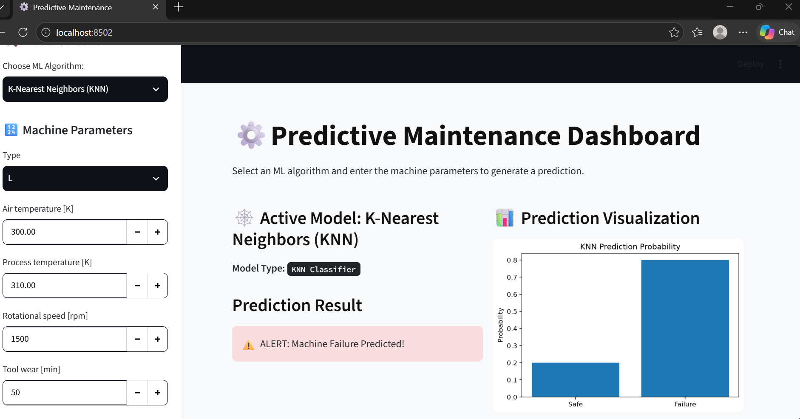
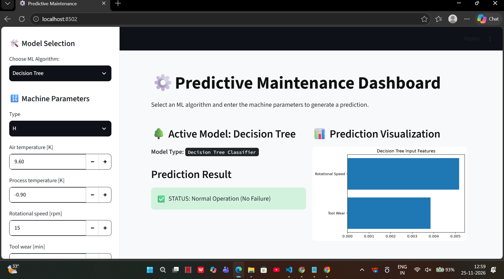

# 🔧 Predictive Maintenance Using Machine Learning

## 📌 Project Overview

Predictive Maintenance is a Machine Learning-based system designed to predict potential machine failures and estimate machine torque using machine operating parameters.

The project uses multiple Machine Learning algorithms for failure classification and Linear Regression for torque prediction. An interactive Streamlit dashboard allows users to enter machine parameters and view prediction results.

## 🎯 Objectives

- Predict whether a machine is likely to fail.
- Compare the performance of multiple classification algorithms.
- Predict machine torque using Linear Regression.
- Provide an interactive dashboard for real-time predictions.
- Support proactive maintenance and reduce unexpected machine downtime.

## 🤖 Machine Learning Models

### 1. Machine Failure Classification

The following classification algorithms are implemented:

| Algorithm | Purpose |
|---|---|
| Logistic Regression | Machine failure classification |
| K-Nearest Neighbors (KNN) | Machine failure classification |
| Decision Tree | Machine failure classification |
| Random Forest | Machine failure classification |

### 2. Torque Prediction

**Linear Regression**

Used to predict the numerical torque value based on machine operating parameters.

## ⚙️ Input Parameters

The system uses machine operating parameters such as:

- Machine Type
- Air Temperature
- Process Temperature
- Rotational Speed
- Torque
- Tool Wear

## 🛠️ Technologies Used

- Python
- Pandas
- NumPy
- Scikit-learn
- Streamlit
- Matplotlib
- Seaborn
- Joblib

## 📂 Project Structure

```text
Predictive-Maintenance/
│
├── app.py
├── requirements.txt
├── .gitignore
├── README.md
│
├── model(dt).pkl
├── model(knn).pkl
├── model(lm).pkl
├── model(log).pkl
└── model(rf).pkl
```

## 🚀 Installation and Execution

### Step 1: Clone the Repository

```bash
git clone https://github.com/anamikaah05/Predictive-Maintenance.git
```

### Step 2: Navigate to the Project Directory

```bash
cd Predictive-Maintenance
```

### Step 3: Install Dependencies

```bash
pip install -r requirements.txt
```

### Step 4: Run the Streamlit Application

```bash
streamlit run app.py
```

## 📊 Application Features

- Interactive Streamlit dashboard.
- Multiple machine failure classification models.
- Model selection and failure prediction.
- Linear Regression-based torque prediction.
- Easy-to-understand prediction results.

## 💡 Expected Outcome

The system helps identify potential machine failures and estimate torque values using machine learning techniques, supporting better maintenance planning and machine monitoring.

## Application Screenshots


### Prediction Results



## 👩‍💻 Author

**Anamika R**

GitHub: [anamikaah05](https://github.com/anamikaah05)

---

⭐ If you find this project interesting, consider giving the repository a star!